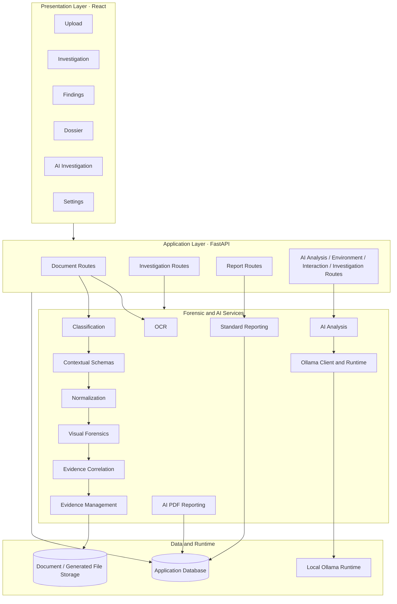
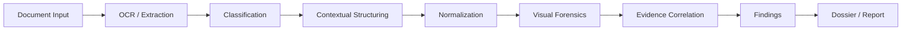
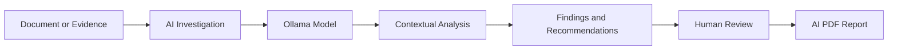

<div align="center">

# 🔍 DECIPHER

### AI-Powered Document Forensics & Verification

**Examine documents. Correlate evidence. Investigate inconsistencies.**

[](https://www.python.org/)
[](https://fastapi.tiangolo.com/)
[](https://react.dev/)
[](https://ollama.com/)
[](LICENSE)

[Overview](#-overview) · [Capabilities](#-capabilities) · [Architecture](#-architecture) · [Getting Started](#-getting-started) · [Configuration](#-configuration) · [Running](#-running-the-application) · [Project Structure](#-project-structure) · [License](#-license)

</div>

---

```text
Standard:  Document -> OCR -> Classify -> Structure -> Normalize -> Visual Forensics -> Correlate -> Findings -> Dossier
AI:        Document / Evidence -> AI Investigation -> Local Ollama Model -> Findings + Recommendations -> Human Review -> PDF Report
```

> [!IMPORTANT]
> Decipher is an **investigative aid**. Its findings are indicators for review, not standalone proof of fraud or document tampering. A qualified human reviewer should evaluate every conclusion against the original evidence.

## 📑 Table of Contents

- [Overview](#-overview)
- [At a Glance](#-at-a-glance)
- [Capabilities](#-capabilities)
- [Architecture](#-architecture)
- [Investigation Workflows](#-investigation-workflows)
- [Technology Stack](#-technology-stack)
- [Getting Started](#-getting-started)
- [Running the Application](#-running-the-application)
- [Configuration](#-configuration)
- [API Reference](#-api-reference)
- [Sample Documents](#-sample-documents)
- [Testing](#-testing)
- [Reporting](#-reporting)
- [Repository Guide](#-repository-guide)
- [Project Structure](#-project-structure)
- [Limitations and Responsible Use](#-limitations-and-responsible-use)
- [Development and Contributions](#-development-and-contributions)
- [License](#-license)

---

## 🔎 Overview

Decipher is a document forensics and verification platform that helps investigators examine digital documents, identify suspicious characteristics, compare related records, and organize evidence into structured findings.

Documents such as invoices, bank statements, and purchase orders can contain inconsistencies that are hard to spot by manual inspection alone. A total that disagrees with a purchase order, a figure that does not reconcile across statements, or a field that looks edited can each be small on its own and meaningful together. Decipher brings document processing, forensic analysis, evidence correlation, and AI-assisted investigation into one application.

The platform provides **two distinct investigation paths**:

| Investigation mode | Purpose |
|---|---|
| 🧪 **Standard Forensic Investigation** | A deterministic processing pipeline for document extraction, classification, normalization, visual examination, and evidence correlation. |
| 🤖 **AI Investigation** | A separate, Ollama-powered workflow for contextual analysis, evidence-based reasoning, investigative recommendations, and analyst interaction. |

The two modes complement each other without making the standard forensic pipeline dependent on a generative AI runtime.

## ✨ At a Glance

| | Capability | Description |
|---|---|---|
| 📄 | **Document examination** | Extract and inspect document content and relevant properties. |
| ⚙️ | **Forensic processing** | Apply OCR, classification, normalization, and visual-forensics services. |
| 🔗 | **Cross-document correlation** | Compare related evidence and surface inconsistencies. |
| 🧠 | **AI-assisted investigation** | Use locally hosted Ollama models for contextual analysis. |
| 🧭 | **Evidence-aware recommendations** | Identify follow-up checks and additional evidence worth examining. |
| 🗂️ | **Investigation records** | Organize findings and supporting evidence. |
| 📑 | **Reporting** | Generate investigation reports, including PDF output where supported by the application. |

---

## 🧩 Capabilities

### 🧪 Standard Forensic Investigation

The standard workflow processes documents through dedicated forensic services to produce structured, traceable findings from extracted and examined evidence.

| Component | Responsibility |
|---|---|
| 🔤 OCR service | Extract text from supported document inputs. |
| 🏷️ Classifier | Identify document categories. |
| 🧱 Contextual schemas | Apply document-aware structures to extracted information. |
| 🧮 Normalization | Convert extracted values into comparable representations. |
| 👁️ Visual forensics | Examine visual characteristics for potential manipulation indicators. |
| 🔗 Correlation | Compare evidence across documents and identify inconsistencies. |
| 🗃️ Evidence manager | Manage evidence associated with the investigation. |
| 📝 Report generator | Produce standard investigation reports. |

### 🤖 AI Investigation

AI Investigation is a separate workflow powered by locally hosted Ollama models. It supports contextual examination and analyst-assisted reasoning over available document evidence.

Its capabilities include AI analysis, model and runtime discovery, investigation interactions, and AI-oriented PDF reporting. The application also supports recommendations that guide further examination, such as checking a discrepancy, reviewing another document, or collecting corroborating evidence.

> [!NOTE]
> AI-generated output should remain distinguishable from deterministic forensic findings. Review AI conclusions against the underlying source material before relying on them.

### 🔀 Separate by Design

| Principle | Meaning |
|---|---|
| 🧪 Standard stays independent | The standard forensic pipeline does not require Ollama for its processing. |
| 🚀 AI can run on its own | AI Investigation can be initiated as its own workflow. |
| 🔌 Optional context | Existing forensic results may be used as additional context where the application supports it. |
| ⚖️ No replacement | AI output is not a replacement for original forensic findings. |
| 🧾 Clear provenance | Findings should retain provenance so reviewers can tell where each one came from. |

---

## 🏗️ Architecture

Decipher follows a layered structure: a React presentation layer, a FastAPI application layer, and a persistence layer for application data and document storage.



<details>
<summary><strong>📌 Architecture notes</strong></summary>

- The frontend is implemented with React and communicates with the backend through the API service layer.
- FastAPI exposes separate route modules for documents, standard investigations, reports, and AI-related operations.
- Standard forensic processing is implemented through dedicated backend services.
- AI-related services include analysis, Ollama communication and runtime handling, and PDF report generation.
- The repository contains database and file-storage components. Read the exact persistence behavior and runtime configuration from `backend/app/database.py`, `backend/app/config.py`, and the startup configuration before deployment.

</details>

---

## 🔄 Investigation Workflows

### 1️⃣ Standard Forensic Investigation



The standard workflow extracts document information, classifies and normalizes it, examines visual characteristics, and correlates evidence to produce structured findings.

### 2️⃣ AI Investigation



The AI workflow uses the configured local Ollama runtime for model inference. Treat AI findings and recommendations as investigative assistance rather than definitive determinations.

---

## 🛠️ Technology Stack

| Layer | Technology | Role |
|---|---|---|
| 🖥️ Frontend | React, JavaScript, Vite | User interface and investigation workflows |
| 🎨 Styling | CSS, Tailwind CSS configuration | Interface styling |
| ⚡ Backend | Python, FastAPI | API and application logic |
| 🗄️ Data access | Backend database module and models | Persistence and data representation |
| 📄 Document analysis | OCR and forensic processing services | Extraction and document examination |
| 🧠 AI runtime | Ollama | Local model inference for AI Investigation |
| ✅ Testing | pytest | Backend test suite |
| 📑 Reporting | Python report-generation services | Investigation and PDF report generation |

> Versions and optional system dependencies are defined by the repository's dependency and configuration files. Check `backend/requirements.txt` and `frontend/package.json` before installing or upgrading components.

---

## 🚀 Getting Started

The repository includes PowerShell startup scripts for the backend and frontend. The steps below set up a local development environment. Ports and startup commands are documented in [Running the Application](#-running-the-application).

### 📋 Prerequisites

| Requirement | Needed for |
|---|---|
| [Git](https://git-scm.com/) | Cloning the repository |
| Python compatible with `backend/requirements.txt` | Backend |
| Node.js and npm compatible with `frontend/package.json` | Frontend |
| [Ollama](https://ollama.com/) plus a locally downloaded model | AI Investigation only |

> [!NOTE]
> **Ollama is required for AI Investigation, not for the standard forensic workflow.** Install it only if you plan to use the AI path.

### 1. Clone the repository

```powershell
git clone https://github.com/Terminella/Decipher.git
cd Decipher
```

### 2. Configure the environment

```powershell
Copy-Item .env.example .env
```

Review `.env.example` and `backend/app/config.py`, and set only the variables the current implementation requires. Do not commit secrets or local credentials.

### 3. Set up the backend

```powershell
py -m venv .venv
.\.venv\Scripts\Activate.ps1
python -m pip install --upgrade pip
pip install -r backend/requirements.txt
```

### 4. Set up the frontend

```powershell
cd frontend
npm install
cd ..
```

### 5. Start the application

From the repository root, use the provided PowerShell scripts:

```powershell
.\scripts\start-backend.ps1
```

In a separate PowerShell terminal:

```powershell
.\scripts\start-frontend.ps1
```

The backend listens on `127.0.0.1:8000` and the frontend dev server on port `5173`. Details are in [Running the Application](#-running-the-application).

### 6. Enable AI Investigation (optional)

Install and start Ollama, then pull a model supported by your local installation. For example:

```powershell
ollama pull llama3.2
```

The model name above is an example, not a project-mandated default. Use the application's model and runtime discovery to select a model that is installed locally. By default the backend looks for Ollama at `http://127.0.0.1:11434` (see [Configuration](#-configuration)).

---

## 🚦 Running the Application

### 🔌 Ports and URLs

| Service | Address | Defined in |
|---|---|---|
| ⚡ Backend (FastAPI) | `127.0.0.1:8000` | `backend/app/main.py`, `scripts/start-backend.ps1` |
| 🖥️ Frontend (React + Vite) | port `5173` | `frontend/vite.config.js`, `scripts/start-frontend.ps1` |
| 🧠 Ollama (local AI runtime) | `127.0.0.1:11434` | `OLLAMA_BASE_URL` default |

### ⚡ Backend

The entry point is `backend/app/main.py`, which exposes the FastAPI application as `app.main:app`. There are three equivalent ways to start it, and all use the same host and port:

| Method | What happens |
|---|---|
| `scripts/start-backend.ps1` | Launches the same FastAPI application on port 8000. Recommended on Windows. |
| Uvicorn importing `app.main:app` | Uvicorn imports the application object from the module and serves it. |
| Running `main.py` directly | The `if __name__ == "__main__"` block calls `_start_server()`, which launches Uvicorn with the command below. |

The command used by `_start_server()`, run from the `backend/` directory so the `app.main:app` import path resolves:

```powershell
uvicorn app.main:app --reload --host 127.0.0.1 --port 8000
```

The difference: importing `app.main:app` through Uvicorn makes Uvicorn the process owner and imports `main.py` as a module, so the `__main__` block does not run. Running `main.py` directly executes the `__main__` block, which starts Uvicorn for you.

### 🖥️ Frontend

`scripts/start-frontend.ps1` runs the Vite development server. Its port is set to `5173` in `frontend/vite.config.js`.

### 🔗 API connection and CORS

- The frontend API client, `frontend/src/services/api.js`, defaults to `http://localhost:8000`.
- The backend CORS configuration allows the frontend origins on port `5173`. It is defined in `backend/app/config.py` and `.env.example`.

If you change a port, update the backend start command, `frontend/vite.config.js`, the API client default, and the CORS settings together.

### 🧠 Ollama

Ollama is **required for AI Investigation** and is **not required for the standard forensic workflow**. Start the Ollama runtime before using the AI Investigation page, and confirm the address in `OLLAMA_BASE_URL`.

---

## 🔧 Configuration

Copy `.env.example` to `.env` and review it alongside `backend/app/config.py`. Do not commit `.env` or any credentials.

| Variable | Purpose | Default |
|---|---|---|
| `OLLAMA_BASE_URL` | Primary Ollama server URL, used for AI runtime and model access | `http://127.0.0.1:11434` |
| `LLM_BASE_URL` | Endpoint used by the contextual LLM service (`llm_service.py`), Ollama's OpenAI-compatible API | `http://localhost:11434/v1` |

CORS origins for the frontend (port `5173`) are also set in `backend/app/config.py` and `.env.example`. Other settings in `.env.example` are not documented here; refer to the file itself.

---

## 📡 API Reference

The backend route modules are organized by responsibility:

| Area | Route module |
|---|---|
| 📄 Documents | [`backend/app/routes/documents.py`](backend/app/routes/documents.py) |
| 🧪 Standard investigations | [`backend/app/routes/investigations.py`](backend/app/routes/investigations.py) |
| 📑 Reports | [`backend/app/routes/reports.py`](backend/app/routes/reports.py) |
| 🧠 AI analysis | [`backend/app/routes/ai_analysis.py`](backend/app/routes/ai_analysis.py) |
| 🌐 AI environment and runtime | [`backend/app/routes/ai_environment.py`](backend/app/routes/ai_environment.py) |
| 💬 AI interactions | [`backend/app/routes/ai_interactions.py`](backend/app/routes/ai_interactions.py) |
| 🕵️ AI investigations | [`backend/app/routes/ai_investigations.py`](backend/app/routes/ai_investigations.py) |

FastAPI's interactive documentation is served at the backend's `/docs` endpoint while the server is running, subject to the configured host and port. That live schema is the authoritative reference for HTTP methods, request bodies, response models, and route paths.

---

## 🗂️ Sample Documents

[`sample_documents/`](sample_documents/) contains example document sets organized into `genuine/` and `manipulated/` collections, along with a `manifest.json` and an accompanying [README](sample_documents/README.md).

| Collection | Contents |
|---|---|
| ✅ `genuine/` | 23 PDFs: bank statement, invoice, and purchase order for CASE-001 to CASE-005, plus eight numbered documents for CASE-201 to CASE-208 |
| ⚠️ `manipulated/` | 34 PDFs: manipulated counterparts for CASE-001 to CASE-005, plus 19 altered documents across CASE-201 to CASE-208 |

Use `manifest.json` and `sample_documents/README.md` to understand the intended case groupings and the characteristics each sample represents.

These files are test and demonstration inputs. A sample classification or forensic indicator is not a general guarantee of detection accuracy.

---

## ✅ Testing

Backend tests are located in [`backend/tests/`](backend/tests/). Run the suite from the repository root after activating the virtual environment:

```powershell
python -m pytest backend/tests -v
```

| Area | Test modules |
|---|---|
| 🧪 Standard forensics | `test_contextual_schemas.py`, `test_correlation.py`, `test_normalization.py`, `test_visual_forensics.py`, `test_llm_service.py` |
| 🤖 AI analysis | `test_ai_analysis.py`, `test_ai_interactions.py` |
| 🔌 Ollama integration | `test_ollama_client.py`, `test_ollama_runtime.py` |
| 📑 PDF reports | `test_pdf_report_generator.py` |
| 🌐 API | `test_api.py` |

Results depend on your local environment and installed dependencies. Run the suite yourself before treating any test status as verified.

---

## 📑 Reporting

Decipher has separate reporting services for standard forensic output and AI-oriented PDF reports:

| Report | Generator |
|---|---|
| 📝 Standard investigation report | [`backend/app/services/report_generator.py`](backend/app/services/report_generator.py) |
| 🤖 AI investigation PDF report | [`backend/app/services/pdf_report_generator.py`](backend/app/services/pdf_report_generator.py) |

Keep the origin of findings clear when reviewing or sharing reports. Identify AI-generated analysis as such, and never present it as a deterministic forensic result.

---

## 📚 Repository Guide

| Document | Description |
|---|---|
| [`docs/ARCHITECTURE.md`](docs/ARCHITECTURE.md) | Architecture and system design |
| [`docs/DEVELOPMENT_STATUS.md`](docs/DEVELOPMENT_STATUS.md) | Current development status |
| [`docs/LIMITATIONS.md`](docs/LIMITATIONS.md) | Known limitations and constraints |
| [`sample_documents/README.md`](sample_documents/README.md) | Sample document dataset notes |

---

## 📂 Project Structure

A quick map of where things live:

| Path | Contents |
|---|---|
| 📁 `backend/app/` | FastAPI application: config, database, models, schemas, routes and services |
| 📁 `backend/tests/` | pytest test suite |
| 📁 `frontend/src/` | React application: pages, components, API client and utilities |
| 📁 `docs/` | Architecture, development status and limitations |
| 📁 `sample_documents/` | Genuine and manipulated sample PDFs plus `manifest.json` |
| 📁 `scripts/` | PowerShell startup scripts for backend and frontend |

```text
Decipher/
│
├── .env.example
├── .gitignore
├── LICENSE
├── README.md
│
├── backend/
│   ├── requirements.txt
│   │
│   ├── app/                                  # FastAPI application
│   │   ├── __init__.py
│   │   ├── ai_schemas.py
│   │   ├── config.py
│   │   ├── database.py
│   │   ├── main.py
│   │   ├── models.py
│   │   ├── schemas.py
│   │   │
│   │   ├── routes/                           # API route modules
│   │   │   ├── __init__.py
│   │   │   ├── ai_analysis.py
│   │   │   ├── ai_environment.py
│   │   │   ├── ai_interactions.py
│   │   │   ├── ai_investigations.py
│   │   │   ├── documents.py
│   │   │   ├── investigations.py
│   │   │   └── reports.py
│   │   │
│   │   └── services/                         # Forensic and AI services
│   │       ├── __init__.py
│   │       ├── ai_analysis.py
│   │       ├── classifier.py
│   │       ├── contextual_schemas.py
│   │       ├── correlation.py
│   │       ├── evidence_manager.py
│   │       ├── llm_service.py
│   │       ├── normalization.py
│   │       ├── ocr_service.py
│   │       ├── ollama_client.py
│   │       ├── ollama_runtime.py
│   │       ├── pdf_report_generator.py
│   │       ├── pipeline.py
│   │       ├── report_generator.py
│   │       ├── run_demo.py
│   │       └── visual_forensics.py
│   │
│   ├── data/
│   │   └── .gitkeep
│   │
│   ├── generated/
│   │   └── .gitkeep
│   │
│   ├── storage/
│   │   └── .gitkeep
│   │
│   └── tests/                                # pytest suite
│       ├── test_ai_analysis.py
│       ├── test_ai_interactions.py
│       ├── test_api.py
│       ├── test_contextual_schemas.py
│       ├── test_correlation.py
│       ├── test_llm_service.py
│       ├── test_normalization.py
│       ├── test_ollama_client.py
│       ├── test_ollama_runtime.py
│       ├── test_pdf_report_generator.py
│       └── test_visual_forensics.py
│
├── frontend/
│   ├── index.html
│   ├── package.json
│   ├── package-lock.json
│   ├── postcss.config.js
│   ├── tailwind.config.js
│   ├── vite.config.js
│   │
│   └── src/                                  # React application
│       ├── App.jsx
│       ├── main.jsx
│       │
│       ├── components/
│       │   ├── AuditTrailModal.jsx
│       │   ├── DocumentSelector.jsx
│       │   ├── DocumentViewer.jsx
│       │   ├── FindingCard.jsx
│       │   └── StatusPill.jsx
│       │
│       ├── pages/
│       │   ├── AIInvestigationPage.css
│       │   ├── AIInvestigationPage.jsx
│       │   ├── DossierPage.jsx
│       │   ├── FindingsPage.jsx
│       │   ├── InvestigationPage.jsx
│       │   ├── SettingsPage.jsx
│       │   └── UploadPage.jsx
│       │
│       ├── services/
│       │   └── api.js
│       │
│       ├── styles/
│       │   └── index.css
│       │
│       └── utils/
│           └── dateTime.js
│
├── docs/
│   ├── ARCHITECTURE.md
│   ├── DEVELOPMENT_STATUS.md
│   └── LIMITATIONS.md
│
├── sample_documents/
│   ├── manifest.json
│   ├── README.md
│   │
│   ├── genuine/                              # 23 genuine PDFs
│   │   ├── CASE-001_bank_statement_genuine.pdf
│   │   ├── CASE-001_invoice_genuine.pdf
│   │   ├── CASE-001_purchase_order_genuine.pdf
│   │   ├── CASE-002_bank_statement_genuine.pdf
│   │   ├── CASE-002_invoice_genuine.pdf
│   │   ├── CASE-002_purchase_order_genuine.pdf
│   │   ├── CASE-003_bank_statement_genuine.pdf
│   │   ├── CASE-003_invoice_genuine.pdf
│   │   ├── CASE-003_purchase_order_genuine.pdf
│   │   ├── CASE-004_bank_statement_genuine.pdf
│   │   ├── CASE-004_invoice_genuine.pdf
│   │   ├── CASE-004_purchase_order_genuine.pdf
│   │   ├── CASE-005_bank_statement_genuine.pdf
│   │   ├── CASE-005_invoice_genuine.pdf
│   │   ├── CASE-005_purchase_order_genuine.pdf
│   │   ├── CASE-201_genuine_01.pdf
│   │   ├── CASE-202_genuine_02.pdf
│   │   ├── CASE-203_genuine_03.pdf
│   │   ├── CASE-204_genuine_04.pdf
│   │   ├── CASE-205_genuine_05.pdf
│   │   ├── CASE-206_genuine_06.pdf
│   │   ├── CASE-207_genuine_07.pdf
│   │   └── CASE-208_genuine_08.pdf
│   │
│   └── manipulated/                          # 34 manipulated PDFs
│       ├── CASE-001_bank_statement_manipulated.pdf
│       ├── CASE-001_invoice_manipulated.pdf
│       ├── CASE-001_purchase_order_manipulated.pdf
│       ├── CASE-002_bank_statement_manipulated.pdf
│       ├── CASE-002_invoice_manipulated.pdf
│       ├── CASE-002_purchase_order_manipulated.pdf
│       ├── CASE-003_bank_statement_manipulated.pdf
│       ├── CASE-003_invoice_manipulated.pdf
│       ├── CASE-003_purchase_order_manipulated.pdf
│       ├── CASE-004_bank_statement_manipulated.pdf
│       ├── CASE-004_invoice_manipulated.pdf
│       ├── CASE-004_purchase_order_manipulated.pdf
│       ├── CASE-005_bank_statement_manipulated.pdf
│       ├── CASE-005_invoice_manipulated.pdf
│       ├── CASE-005_purchase_order_manipulated.pdf
│       ├── CASE-201_altered_01.pdf
│       ├── CASE-201_altered_09.pdf
│       ├── CASE-201_altered_17.pdf
│       ├── CASE-202_altered_02.pdf
│       ├── CASE-202_altered_10.pdf
│       ├── CASE-202_altered_18.pdf
│       ├── CASE-203_altered_03.pdf
│       ├── CASE-203_altered_11.pdf
│       ├── CASE-203_altered_19.pdf
│       ├── CASE-204_altered_04.pdf
│       ├── CASE-204_altered_12.pdf
│       ├── CASE-204_altered_20.pdf
│       ├── CASE-205_altered_05.pdf
│       ├── CASE-206_altered_06.pdf
│       ├── CASE-206_altered_14.pdf
│       ├── CASE-207_altered_07.pdf
│       ├── CASE-207_altered_15.pdf
│       ├── CASE-208_altered_08.pdf
│       └── CASE-208_altered_16.pdf
│
└── scripts/
    ├── start-backend.ps1
    └── start-frontend.ps1
```

## ⚠️ Limitations and Responsible Use

- A forensic indicator is not, by itself, proof that a document is fraudulent or manipulated.
- OCR and extraction quality vary with scan quality, layout, resolution, and document structure.
- Similar-looking values or inconsistent records can have legitimate explanations.
- Confidence scores and AI assessments are not proof of wrongdoing.
- AI-generated conclusions can be incomplete or incorrect and require independent review.
- Preserve original files and evidence provenance. Do not rely solely on transformed or extracted representations.
- Review [`docs/LIMITATIONS.md`](docs/LIMITATIONS.md) before using the system for an operational investigation.

Decipher should support a review process, not replace professional judgment or established verification procedures.

---

## 🤝 Development and Contributions

1. Fork the repository.
2. Create a focused feature branch.
3. Keep changes scoped, and add or update tests where appropriate.
4. Run the relevant test suite (see [Testing](#-testing)).
5. Open a pull request describing the change and how you verified it.

For architectural context, see [`docs/ARCHITECTURE.md`](docs/ARCHITECTURE.md). For current implementation status, see [`docs/DEVELOPMENT_STATUS.md`](docs/DEVELOPMENT_STATUS.md).

---

## 📄 License

This project is licensed under the **MIT License**. See the [LICENSE](LICENSE) file for the full license text.

<div align="center">

<sub>Decipher supports human review. It does not replace it.</sub>

</div>
